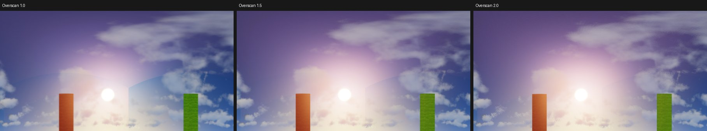

# Verification

Results of `tools/verify/matrix.py` on real clients. Generated by `tools/verify/report.py` - do not
edit by hand. What a run does and what **OK** means: [Development](development.md#the-real-client-self-test).

Generated: 2026-10-17

## Without shader mods

| Minecraft | Result | Notes |
| --- | --- | --- |
| 26.3 | OK | crop 720 px, FOV 90.0 |
| 26.2 | OK | crop 720 px, FOV 90.0 |
| 26.1.2 | OK | crop 720 px, FOV 90.0 |
| 1.21.11 | OK | crop 720 px, FOV 90.0 |
| 1.21.10 | OK | crop 720 px, FOV 90.0 |
| 1.21.8 | OK | crop 720 px, FOV 90.0 |
| 1.21.5 | OK | crop 720 px, FOV 90.0 |
| 1.21.4 | OK | crop 720 px, FOV 90.0 |
| 1.21.3 | OK | crop 720 px, FOV 90.0 |
| 1.21.1 | OK | crop 720 px, FOV 90.0 |
| 1.20.6 | OK | crop 720 px, FOV 90.0 |
| 1.20.4 | OK | crop 720 px, FOV 90.0 |
| 1.20.1 | OK | crop 720 px, FOV 90.0 |
| 1.19.4 | OK | crop 720 px, FOV 90.0 |
| 1.19.3 | OK | crop 720 px, FOV 90.0 |
| 1.19.2 | OK | crop 720 px, FOV 90.0 |
| 1.18.2 | OK | crop 720 px, FOV 90.0 |
| 1.17.1 | OK | crop 720 px, FOV 90.0 |
| 1.16.5 | OK | crop 720 px, FOV 90.0 |
| 1.16.1 | OK | crop 720 px, FOV 90.0 |
| 1.15.2 | OK | crop 720 px, FOV 90.0 |
| 1.14.4 | OK | crop 720 px, FOV 90.0 |

## With Iris + BSL Shaders

| Minecraft | Result | Notes |
| --- | --- | --- |
| 26.3 | OK | crop 480 px, FOV 112.619865; Iris |
| 26.2 | OK | crop 480 px, FOV 112.619865; Iris |
| 26.1.2 | OK | crop 480 px, FOV 112.619865; Iris |
| 1.21.11 | OK | crop 480 px, FOV 112.619865; Iris |
| 1.21.8 | OK | crop 480 px, FOV 112.619865; Iris |
| 1.21.4 | OK | crop 480 px, FOV 112.619865; Iris |
| 1.21.1 | OK | crop 480 px, FOV 112.619865; Iris |
| 1.20.1 | OK | crop 480 px, FOV 112.619865; Iris |
| 1.18.2 | OK | crop 480 px, FOV 112.619865; Iris |
| 1.16.5 | OK | crop 480 px, FOV 112.619865; Iris |

## With Iris + Complementary Reimagined

| Minecraft | Result | Notes |
| --- | --- | --- |
| 26.2 | OK | crop 480 px, FOV 112.619865; Iris |
| 1.21.1 | OK | crop 480 px, FOV 112.619865; Iris |

## With OptiFabric + OptiFine + BSL Shaders (Fabric Loader 0.15.11)

| Minecraft | Result | Notes |
| --- | --- | --- |
| 1.20.1 | OK | crop 480 px, FOV 112.619865; optifabric-1.14.3, OptiFine_1.20.1_HD_U_I6 |
| 1.16.5 | OK | crop 480 px, FOV 112.619865; optifabric-1.14.3, OptiFine_1.16.5_HD_U_G8 |

## With Canvas (its own pipeline, no shader pack)

| Minecraft | Result | Notes |
| --- | --- | --- |
| 1.20.1 | OK | crop 480 px, FOV 112.619865; canvas-fabric-20.0.2625; pipeline canvas_basic |
| 1.20.1 (canvas_standard) | OK | crop 480 px, FOV 112.619865; canvas-fabric-20.0.2625; pipeline canvas_standard |
| 1.18.2 | OK | crop 480 px, FOV 112.619865; canvas-fabric-18.2.2621; pipeline canvas_basic |

## Vulkan backend (26.2+)

| Minecraft | Result | Notes |
| --- | --- | --- |
| 26.3 | OK | crop 720 px, FOV 90.0 |
| 26.2 | OK | crop 720 px, FOV 90.0 |

## Overscan and screen-space god rays

Sildur's Vibrant Extreme draws its god rays and sun glow in screen space (radial sampling towards the
sun's screen position, faded towards the screen edge). The world clock is frozen at `--time 2000`:
the sun is about 40° up in the east, and the pack tilts the sun path towards the south, so the sun
sits near the corner of the east, south and up faces. Each value is the colour step across a face
seam divided by the step between neighbouring pixels inside the faces (1 = as smooth as the inside
of a face; larger = a visible edge; E/S is never 1 because the test armour stand stands on that
seam). Images: `faces-sheet.png` and `panorama-*.png` in each run's `selftest` folder.

In the image above (OptiFabric, regenerate it with the runs if they change): at 1.0 the sun glow
stops at the up/east seam (the arc above the sun) and at the east/south seam (the vertical step); at
1.5 the arc is nearly gone but the vertical step remains, because seen from the south face the sun
is still outside the 113° render; at 2.0 (127°) both are gone. With Iris the same pack showed no
clear edge at either setting. The yellowish translucent blobs some faces show are the pack's
screen-space lens flares, which each face draws at its own mirrored position - Overscan cannot fix
those.

| Minecraft | Shader mod | Overscan | up/E | E/S | up/S | other seams (max) | Run |
| --- | --- | --- | --- | --- | --- | --- | --- |
| 1.20.1 | Iris | 1.0 | 1.17 | 2.26 | 2.01 | 2.83 | OK |
| 1.20.1 | Iris | 1.5 | 0.94 | 2.43 | 1.89 | 3.22 | OK |
| 1.20.1 | OptiFabric | 1.0 | 2.85 | 3.29 | 3.35 | 1.98 | OK |
| 1.20.1 | OptiFabric | 1.5 | 1.46 | 2.44 | 3.2 | 2.27 | OK |
| 1.20.1 | OptiFabric | 2.0 | 0.86 | 1.79 | 1.25 | 2.44 | OK |
